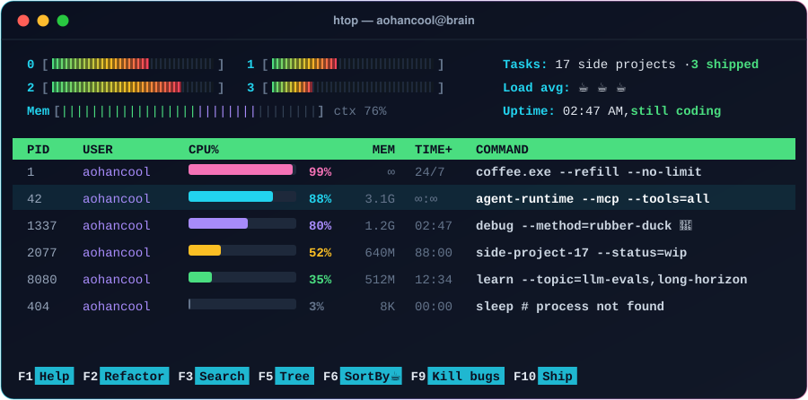

<!-- Generated by build.py — 修改 CONFIG 后重新运行即可 -->

  

  
  
  

## 🧑‍💻 About Me

  

## 🔄 How I Build Agents

  

  

## ⚙️ Currently Running

  

## 🛠️ Tech Stack

  
   
  

         

## 📊 GitHub Stats

  
  

  

  

  <picture>
    <source media="(prefers-color-scheme: dark)" srcset="https://raw.githubusercontent.com/Aohancool/Aohancool/output/github-snake-dark.svg"/>
    <source media="(prefers-color-scheme: light)" srcset="https://raw.githubusercontent.com/Aohancool/Aohancool/output/github-snake.svg"/>
    
  </picture>

  

